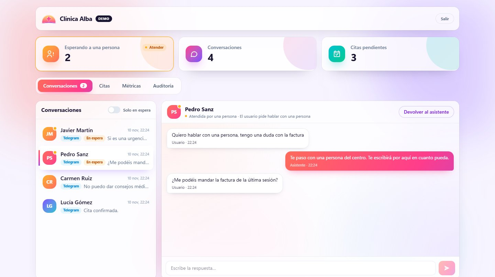
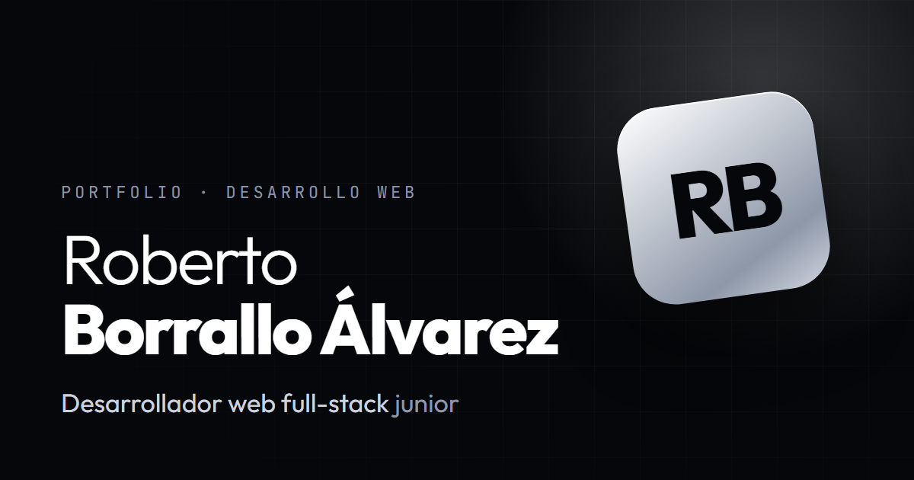

Desarrollador web full-stack. Interfaces con React y TypeScript, APIs en Node.js y Laravel, bases de datos relacionales con seguridad por filas, asistentes conversacionales con IA y experimentos visuales con canvas y WebGL.

## Proyectos

<table>
  <tr>
    <td width="48%">
      <h3>DistribuTech Pro</h3>
      
      
      
      
      
Plataforma B2B de cotizaciones con control de stock.

      <a href="https://distributech-pro.vercel.app">Demo</a> · <a href="https://github.com/robertorayo/DistribuTech-Pro">Código</a>
    </td>
    <td width="52%">
      
    </td>
  </tr>
  <tr>
    <td width="52%">
      
    </td>
    <td width="48%">
      <h3>Agente de citas con IA</h3>
      
      
      
      
      
Asistente para un centro médico ficticio que atiende por Telegram y por chat web, reserva y cancela citas con herramientas y pasa la conversación a una persona cuando hace falta.

      <a href="https://agente-citas-telegram.onrender.com">Demo</a> · <a href="https://agente-citas-telegram.onrender.com/panel/?demo">Panel (demo)</a> · <a href="https://t.me/turnos_demobot">Telegram</a> · <a href="https://github.com/robertorayo/agente-citas-telegram">Código</a>
    </td>
  </tr>
  <tr>
    <td width="48%">
      <h3>Portfolio</h3>
      
      
      
      
Web con carrusel 3D en Three.js y animaciones con GSAP.

      <a href="https://portfolio-eight-psi-g07adxw176.vercel.app/">Web</a> · <a href="https://github.com/robertorayo/portfolio">Código</a>
    </td>
    <td width="52%">
      
    </td>
  </tr>
  <tr>
    <td width="52%">
      
    </td>
    <td width="48%">
      <h3>Shenron</h3>
      
      
      
      
Web narrativa guiada por el scroll con un oráculo con IA: el dragón responde a cada deseo con su propia voz.

      <a href="https://shenronwebsite.vercel.app">Web</a> · <a href="https://github.com/robertorayo/ShenronWebSite">Código</a>
    </td>
  </tr>
</table>

## Stack

<table>
  <tr><td><b>Frontend</b></td><td>React, TypeScript, Vite, Tailwind CSS, HTML, CSS, JavaScript, Three.js</td></tr>
  <tr><td><b>Datos y backend</b></td><td>Node.js, PHP (Laravel), PostgreSQL, Supabase, SQL, Java (JDBC, Hibernate), Python</td></tr>
  <tr><td><b>IA y bots</b></td><td>Modelos de lenguaje con herramientas, bots de Telegram (grammY)</td></tr>
  <tr><td><b>Herramientas</b></td><td>Git, GitHub Actions, Docker, Pest, Maven, JUnit, Vercel, Render</td></tr>
</table>

## Contacto

