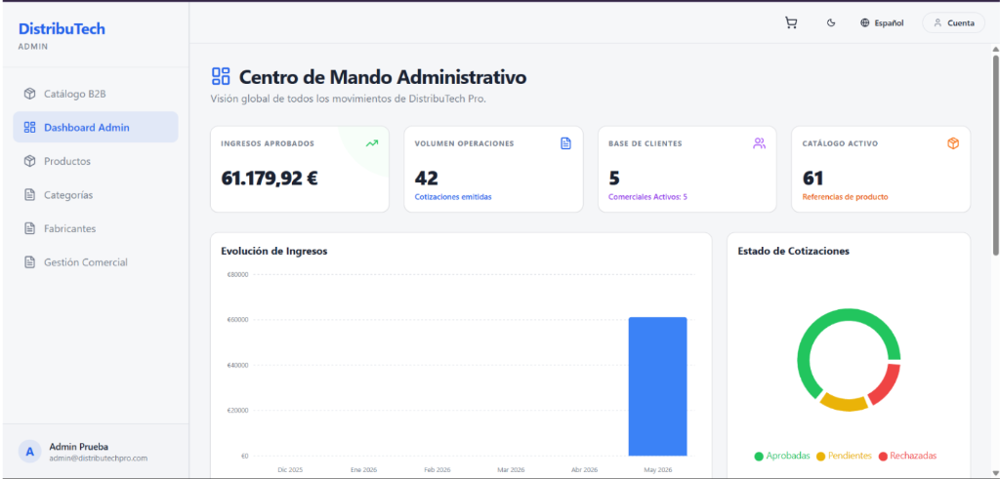
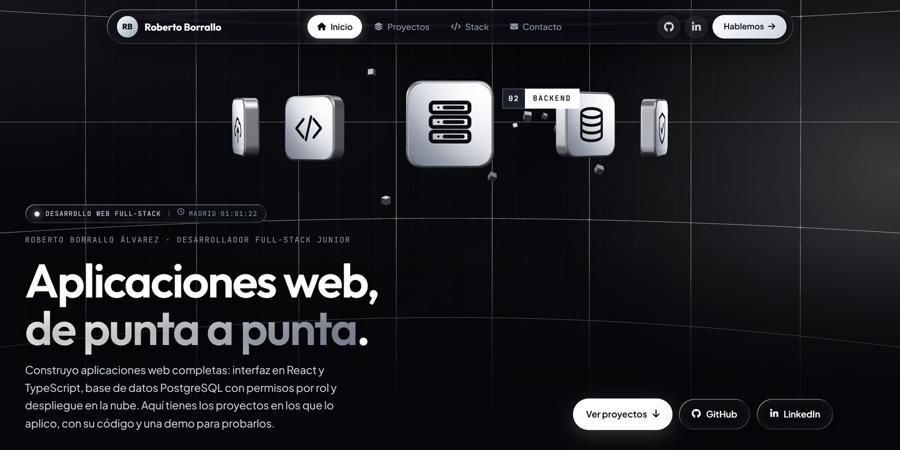
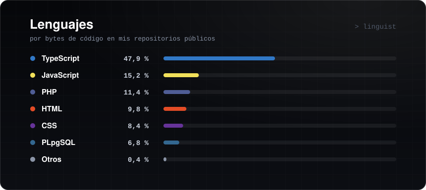

## Proyectos

<table>
  <tr>
    <td width="48%">
      <h3>DistribuTech Pro</h3>
      
      
      
      
      
Plataforma B2B de cotizaciones con control de stock.

      <a href="https://distributech-pro.vercel.app">Demo</a> · <a href="https://github.com/robertorayo/DistribuTech-Pro">Código</a>
    </td>
    <td width="52%">
      
    </td>
  </tr>
  <tr>
    <td width="52%">
      
    </td>
    <td width="48%">
      <h3>Agente de citas con IA</h3>
      
      
      
      
      
Asistente para un centro médico ficticio que atiende por Telegram y por chat web, reserva y cancela citas con herramientas y pasa la conversación a una persona cuando hace falta.

      <a href="https://agente-citas-telegram.onrender.com">Demo</a> · <a href="https://agente-citas-telegram.onrender.com/panel/?demo">Panel (demo)</a> · <a href="https://t.me/turnos_demobot">Telegram</a> · <a href="https://github.com/robertorayo/agente-citas-telegram">Código</a>
    </td>
  </tr>
  <tr>
    <td width="48%">
      <h3>Portfolio</h3>
      
      
      
      
Web con carrusel 3D en Three.js, animaciones con GSAP y cristal líquido con filtros SVG.

      <a href="https://roberto-borrallo.vercel.app/">Web</a> · <a href="https://github.com/robertorayo/portfolio">Código</a>
    </td>
    <td width="52%">
      
    </td>
  </tr>
  <tr>
    <td width="52%">
      
    </td>
    <td width="48%">
      <h3>Shenron</h3>
      
      
      
      
Web narrativa guiada por el scroll con un oráculo con IA: el dragón responde a cada deseo con su propia voz.

      <a href="https://shenronwebsite.vercel.app">Web</a> · <a href="https://github.com/robertorayo/ShenronWebSite">Código</a>
    </td>
  </tr>
</table>

## Stack

<table>
  <tr>
    <td><b>Frontend</b></td>
    <td>
      
      
      
      
      
      
      
      
    </td>
  </tr>
  <tr>
    <td><b>Datos y backend</b></td>
    <td>
      
      
      
      
      
      
      
      
      
    </td>
  </tr>
  <tr>
    <td><b>IA y bots</b></td>
    <td>
      
      
    </td>
  </tr>
  <tr>
    <td><b>Herramientas</b></td>
    <td>
      
      
      
      
      
      
      
      
    </td>
  </tr>
</table>

 

## Contacto

